# ApproveFlow – Maker-Checker Loan Approval System

[](https://github.com/ChamodKodithuwakku/ApproveFlow---Lanka-demo-bank/actions/workflows/ci.yml)


ApproveFlow is a loan-approval workflow for **Lanka Demo Bank**, a *fictional* organisation. It is built to the
standard expected of regulated banking software: **segregation of duties (four-eyes principle)**, **approval limits
with dual approval**, **optimistic concurrency**, an **append-only audit trail**, secure-by-default configuration and
a documented REST API. Currency is LKR and every date is shown in Asia/Colombo time.

> Portfolio project. "Lanka Demo Bank" and all customers, NICs and people in the data set are invented. No real
> bank's name, logo or branding is used.

---

## Contents

- [Features](#features) · [Architecture](#architecture) · [Tech stack](#tech-stack)
- [Run it locally](#run-it-locally) · [Demo login](#demo-login) · [Screenshots](#screenshots)
- [REST API](#rest-api) · [Tests](#tests) · [Project structure](#project-structure)
- [Deployment](#deployment) · [Documentation](#documentation)

## Features

**Maker-checker workflow** (enforced in the domain and application layers, never only in the UI)
- `Draft → Submitted → Approved | Rejected | ReturnedForCorrection`, with `ReturnedForCorrection → Submitted`.
- **Four-eyes principle**: whoever created, last edited or submitted an application can never approve, reject or
  return it. This holds even for a misconfigured user who has both roles.
- **Approval limits**: a Checker approves up to their limit (LKR). Above it, the approval is recorded as the first of
  two (`PendingSecondApproval`) and a *different* Checker must approve.
- Reject and Return require remarks (minimum 10 characters). Approved and Rejected applications are immutable.
- **Optimistic concurrency** (SQL Server `rowversion`): if two Checkers act on the same record, the second gets a
  clear "record was modified by another user" message (HTTP 409 in the API).
- Every state change writes an `ApprovalAction` (who, action, remarks, timestamp), shown as a timeline.
- References in the format `LDB-YYYY-000001` from a SQL Server `SEQUENCE`; live EMI and debt-burden-ratio calculation.

**Audit and compliance**
- An EF Core `SaveChanges` interceptor writes an `AuditLog` row for every insert/update/delete: table, key, action,
  old/new values (JSON), changed columns, user, IP address, correlation id and UTC timestamp. The audit row is written
  **in the same transaction** as the change.
- Sign-ins, failed sign-ins, lockouts, logouts, token issuance, access-denied events, exports and AI requests are
  logged as security events.
- Append-only, enforced three ways: no update/delete code path, an interceptor guard, and a database trigger
  (`trg_AuditLogs_AppendOnly`), plus a `DENY` script for the runtime login.
- Auditor UI: filter by date range, user, entity, action and event type; old/new JSON viewer; CSV export
  (formula-injection safe, and the export itself is audited).

**Reporting (SQL Server depth)**
- `usp_GetApprovalSummary(@FromDate, @ToDate, @BranchId NULL)`: counts and totals by status, branch and product, plus
  average turnaround from first submission to final decision.
- `usp_GetCheckerPerformance` and `vw_PendingApprovalsAging` (0-2 / 3-5 / 6+ day buckets) drive the Reports page,
  the reports API and the dashboard ageing chart. Called through parameterised ADO.NET.
- Sensible composite, unique and filtered indexes, restrictive foreign keys and check constraints. See
  [`database/README.md`](database/README.md).

**Data migration**
- Admin CSV upload of legacy loans with per-row validation (required fields, types, ranges, product limits, NIC
  format, duplicate references, unknown branch/product). Valid rows are imported in **one transaction**; invalid rows
  are stored with line number and reason. The **reconciliation report** compares rows and amounts in the file with
  those imported and rejected. Duplicate uploads are blocked by SHA-256 fingerprint.
- Sample file with 11 deliberately invalid rows: [`docs/sample-legacy-loans.csv`](docs/sample-legacy-loans.csv).

**AI risk summary (advisory)**
- "Generate AI Risk Summary" for Checkers and Auditors, labelled *"AI-generated – advisory only, final decision rests
  with the Checker"*.
- Calls the Claude Messages API through `HttpClient`, with provider, model, endpoint and key from configuration, and
  schema-constrained JSON output. **Privacy by construction**: the input type has no field for name, NIC, phone,
  address or free text.
- Without an API key (or on any failure) a deterministic rule-based assessment is shown, so the feature always works.
  Every request is audited, including the exact anonymised payload.

**Security**: Identity password policy and lockout after 5 failures, role policies on every endpoint with a deny-by-default
fallback, anti-forgery on all POSTs, strict CSP and security headers, HSTS, rate limiting on sign-in and API, JWT
revocation on deactivation or role change, ProblemDetails without stack traces, and secrets kept outside the
repository. See [`docs/Security.md`](docs/Security.md) for the OWASP Top 10 mapping.

## Architecture

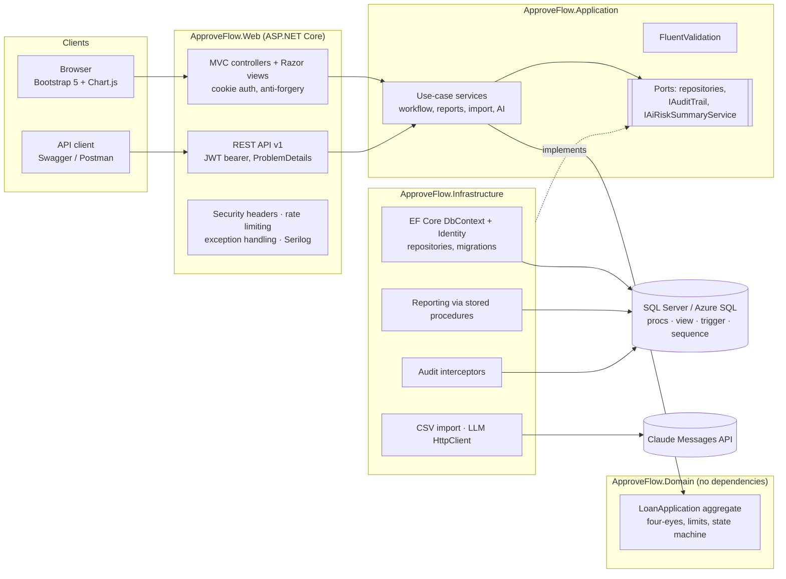

Clean Architecture: dependencies point inwards. Domain has no package references, Application has no EF Core
reference, and Infrastructure implements the Application's ports. Details, ERD, state diagram and design decisions are
in [`docs/Technical-Design.md`](docs/Technical-Design.md).

## Tech stack

| Area | Technology |
|---|---|
| Runtime | .NET 10 (LTS), C# 12. Target framework set once in `Directory.Build.props` and switchable to `net8.0` |
| Web | ASP.NET Core MVC (Razor) + Web API in one host |
| Data | SQL Server 2019+ / Azure SQL, EF Core 10 code-first migrations; SQLite for tests and the zero-install demo |
| Identity | ASP.NET Core Identity with roles; cookies for the UI, JWT bearer for the API |
| Validation | FluentValidation (server, authoritative) + DataAnnotations (client hints) |
| Logging | Serilog (console + rolling file), request logging, correlation ids |
| API docs | Swashbuckle / OpenAPI with XML comments and Bearer "Authorize" |
| UI | Bootstrap 5.3, Bootstrap Icons, Chart.js 4. Served locally, no CDN, strict CSP |
| CSV | CsvHelper |
| Tests | xUnit, WebApplicationFactory, SQLite in-memory, T-SQL ScriptDom parser |
| CI/CD | GitHub Actions (build, test, coverage, idempotent SQL script, publish artifact), deploy jobs ready to enable |

Package versions are managed centrally in `Directory.Packages.props`.

## Run it locally

Prerequisite: the [.NET 10 SDK](https://dotnet.microsoft.com/download). SQL Server is optional for a first look.

### Option A: quick demo, no database install (SQLite)

```bash
git clone https://github.com/ChamodKodithuwakku/ApproveFlow---Lanka-demo-bank.git && cd ApproveFlow---Lanka-demo-bank
powershell -ExecutionPolicy Bypass -File scripts/setup-dev.ps1   # Linux/macOS: ./scripts/setup-dev.sh (stores the demo password + JWT key in user-secrets)
dotnet run --project src/ApproveFlow.Web --launch-profile sqlite-demo
```

Open <http://localhost:5080>. The database file is created and seeded on first start; delete
`src/ApproveFlow.Web/approveflow-demo.db` to reset. In this mode the stored procedures, view and trigger are replaced
by equivalent LINQ queries, because they are SQL Server objects.

### Option B: SQL Server (full feature set)

LocalDB (Windows):
```bash
powershell -ExecutionPolicy Bypass -File scripts/setup-dev.ps1 -LocalDb
dotnet run --project src/ApproveFlow.Web --launch-profile http
```

Docker (any OS):
```bash
powershell -ExecutionPolicy Bypass -File scripts/setup-dev.ps1 -Docker   # creates .env (random SA password) and sets the connection string
docker compose up -d
dotnet run --project src/ApproveFlow.Web --launch-profile http
```

Open <http://localhost:5001> (or the `https` profile on <https://localhost:7048>). In Development, migrations
(tables, procedures, view, trigger, sequence) are applied and demo data is seeded automatically. To apply migrations
yourself:

```bash
dotnet tool restore
dotnet tool run dotnet-ef database update --project src/ApproveFlow.Infrastructure --startup-project src/ApproveFlow.Infrastructure --connection "Server=(localdb)\MSSQLLocalDB;Database=ApproveFlow;Trusted_Connection=True;TrustServerCertificate=True"
```

Optional: to enable the LLM for the AI risk summary, run `powershell -ExecutionPolicy Bypass -File scripts/setup-dev.ps1 -AiApiKey "<your key>"`.

## Demo login

Seeded in **Development only**. All accounts share the password stored in `Seed:DemoPassword`; the setup script uses
**`ApproveFlow@2026`** unless you pass `-DemoPassword`.

| Account | Role | Branch | Approval limit |
|---|---|---|---|
| `admin@demo.lk` | Admin | Colombo | – |
| `maker1@demo.lk` | Maker | Colombo | – |
| `maker2@demo.lk` | Maker | Kandy | – |
| `checker1@demo.lk` | Checker | Colombo | LKR 2,000,000 |
| `checker2@demo.lk` | Checker | Galle | LKR 10,000,000 |
| `auditor@demo.lk` | Auditor (read-only) | Colombo | – |

The seed also creates 3 branches, 4 loan products, 30 fictional customers and 60 applications in every status (with
full approval histories). It is deterministic, so demos are repeatable. The UAT walkthrough is in
[`docs/UAT-Test-Plan.md`](docs/UAT-Test-Plan.md).

## Screenshots

| | |
|---|---|
| 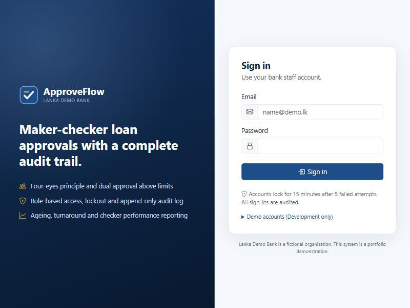 Sign-in with lockout policy | 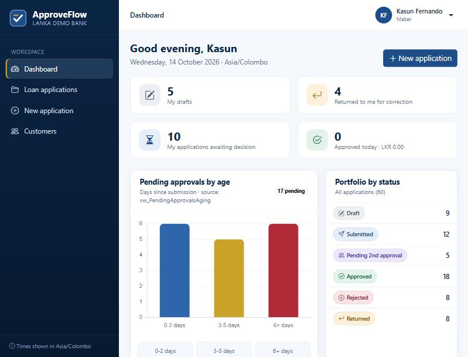 Role-aware dashboard and ageing chart |
| 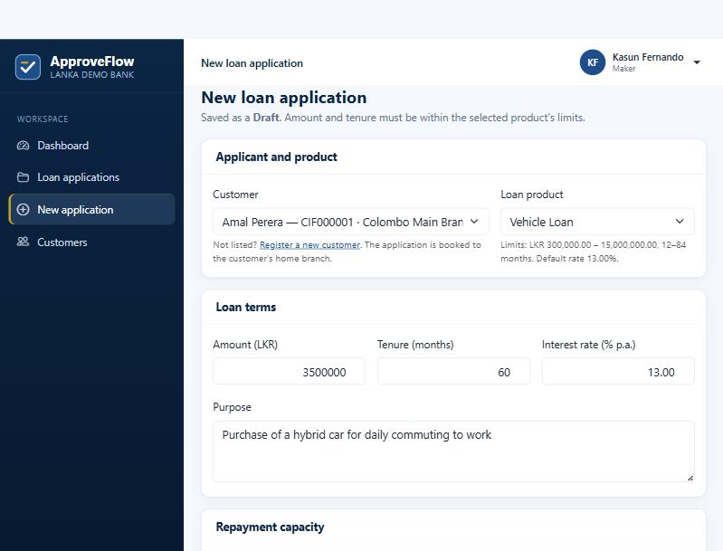 Application form with product limits and live EMI/DBR | 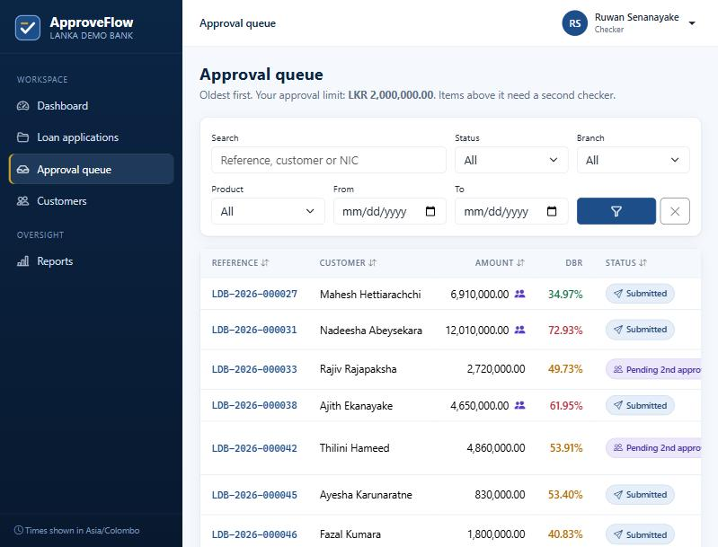 Checker queue: oldest first, dual-approval markers |
| 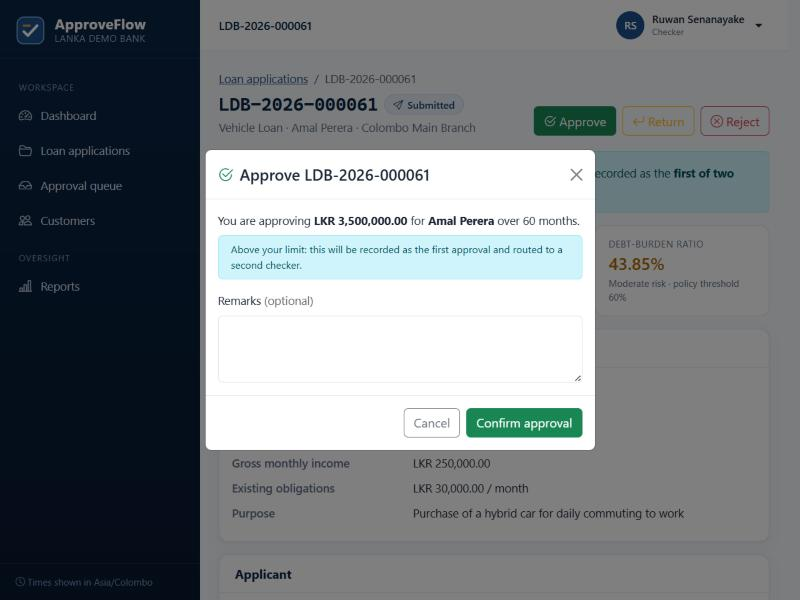 Approval dialog warns when above limit | 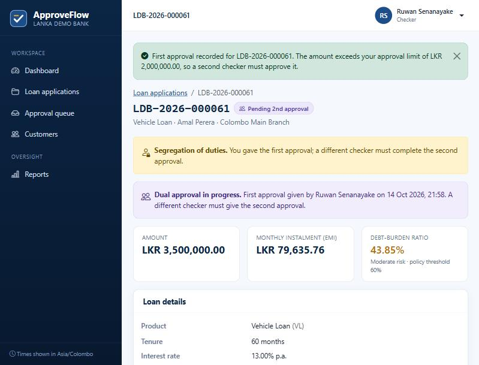 First approval recorded; same checker blocked |
| 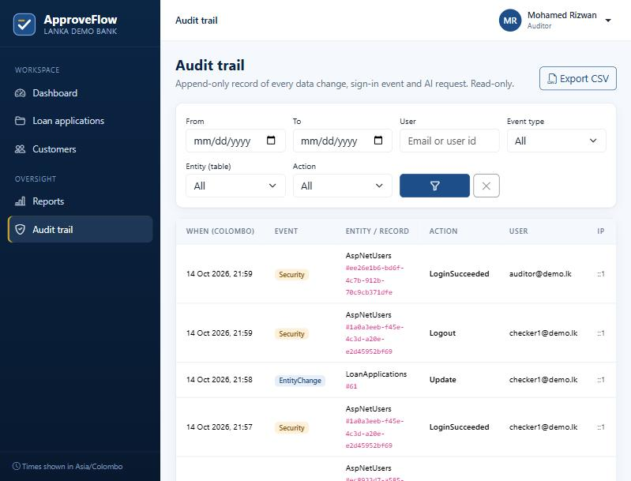 Audit trail with old/new values | 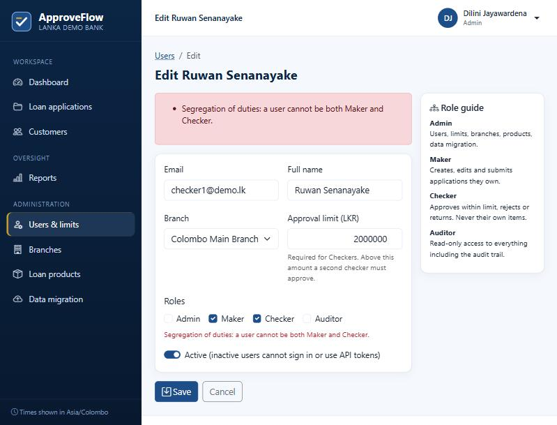 Maker + Checker role combination rejected |
| 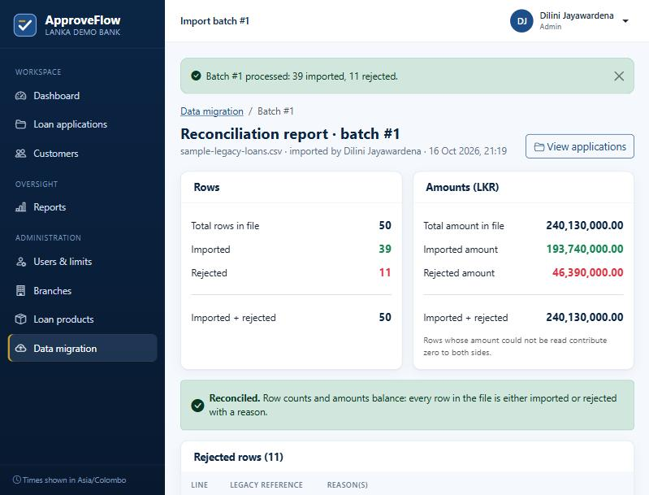 Data migration reconciliation | 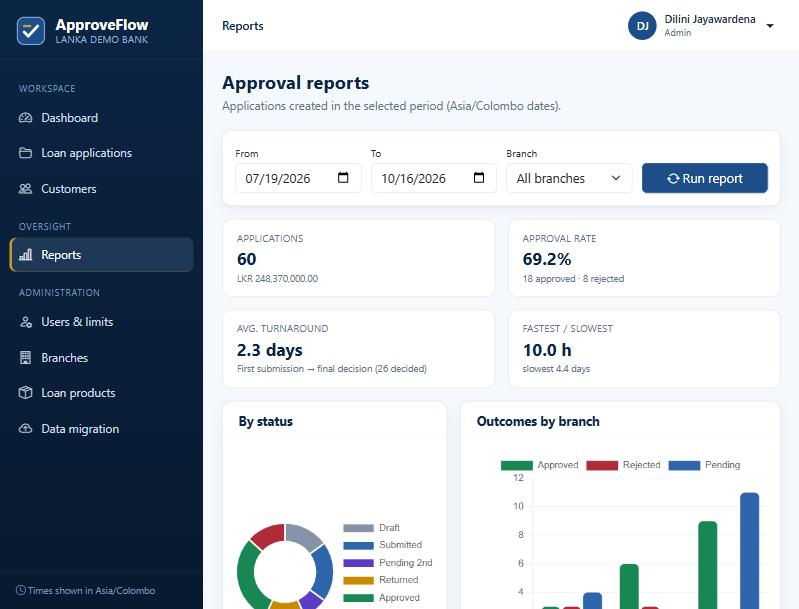 Reports from the stored procedures |
| 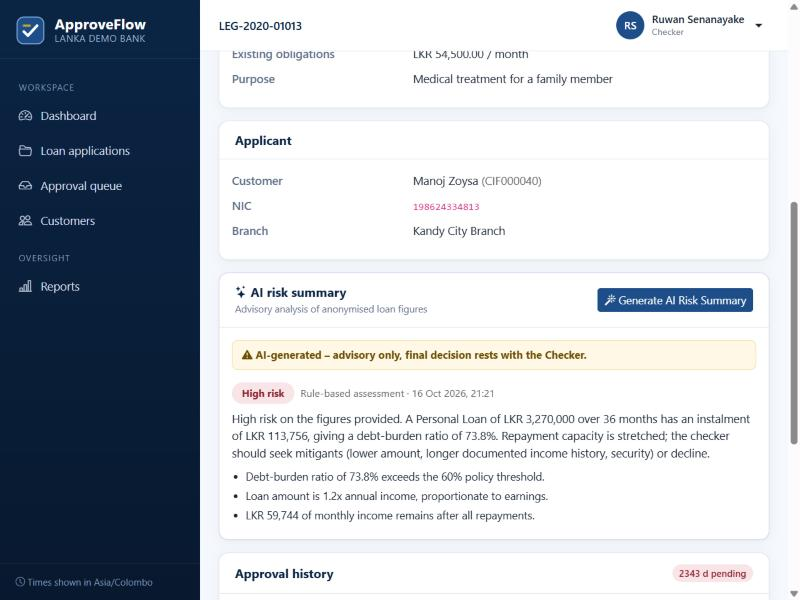 Advisory AI risk summary | 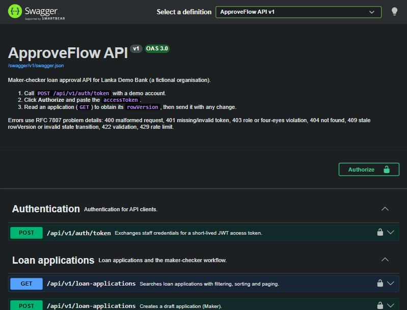 Documented REST API |

## REST API

Versioned under `/api/v1`, JWT-protected, documented at `/swagger` (enabled in Development; set `Swagger:Enabled` elsewhere).

| Method | Path | Roles |
|---|---|---|
| POST | `/api/v1/auth/token` | anonymous (rate limited) |
| GET | `/api/v1/loan-applications?status=&branchId=&fromDate=&toDate=&search=&sortBy=&sortDirection=&page=&pageSize=` | all staff |
| GET | `/api/v1/loan-applications/{id}` · `/{id}/history` | all staff |
| POST / PUT | `/api/v1/loan-applications` · `/{id}` | Maker |
| POST | `/api/v1/loan-applications/{id}/submit` | Maker (owner) |
| POST | `/api/v1/loan-applications/{id}/approve` · `/reject` · `/return` | Checker |
| GET | `/api/v1/reports/summary` · `/reports/checker-performance` | Admin, Checker, Auditor |

Errors are RFC 7807 problem details with a stable `code`: **400** malformed request, **401** missing/invalid/revoked
token, **403** role or four-eyes violation, **404** not found, **409** stale `rowVersion` or invalid state transition,
**422** validation or business rule, **429** rate limited.

```bash
TOKEN=$(curl -s -X POST http://localhost:5080/api/v1/auth/token -H "Content-Type: application/json" \
  -d '{"email":"checker2@demo.lk","password":"ApproveFlow@2026"}' | jq -r .accessToken)
curl -s "http://localhost:5080/api/v1/loan-applications?status=Submitted&pageSize=5" -H "Authorization: Bearer $TOKEN" | jq
```

## Tests

```bash
dotnet test
```

92 tests run in about 10 seconds with no SQL Server, against SQLite in-memory and the real DI graph and HTTP pipeline:

- **Workflow**: maker cannot approve own application (even holding both roles); checker over limit triggers dual
  approval; same checker cannot complete it; reject/return without remarks fail; approved records cannot be edited;
  stale `rowVersion` and a true database race are both detected; every state change creates an `ApprovalAction`.
- **Audit**: update rows carry old/new JSON, changed columns, user, IP and correlation id; inserts get the
  database-generated key in the same transaction; audit rows are append-only; secrets are never logged.
- **API**: 401 without or with a tampered token, 403 for the wrong role, 404, 409, 422, the full workflow over HTTP,
  token revocation on deactivation, and the OpenAPI document.
- **Security**: CSP and headers, anti-forgery rejection, login redirect, lockout after 5 failures.
- **Migration**: the sample CSV imports 39 rows and rejects 11 at the exact lines, reconciles totals and blocks re-import.
- **Reports / SQL**: totals consistent across breakdowns; **every T-SQL script parses** with the SQL Server 2022 grammar.
- **AI**: privacy-by-construction input, deterministic fallback, structured-output request shape, failure fallbacks.

## Project structure

```
src/ApproveFlow.Domain          entities, value objects, workflow rules, calculator (no dependencies)
src/ApproveFlow.Application     use cases, DTOs, validators, ports (interfaces)
src/ApproveFlow.Infrastructure  EF Core, Identity, migrations, interceptors, repositories, reporting, CSV import, AI client
src/ApproveFlow.Web             MVC UI, REST API, Swagger, security middleware, Program.cs
tests/ApproveFlow.Tests         unit + integration tests
database/                       stored procedures, view, trigger, idempotent schema, security and seed scripts
docs/                           requirements, technical design, UAT plan, security, deployment, sample CSV, screenshots
.github/workflows/ci.yml        CI pipeline (+ ready-to-enable deployment jobs)
```

## Deployment

The app is published as a framework-dependent ASP.NET Core application (`dotnet publish -c Release`) and runs on IIS
(Windows shared hosts such as MonsterASP.NET / SmarterASP.NET, or Azure App Service) against SQL Server or Azure SQL.
Configuration comes from environment variables only (`ConnectionStrings__DefaultConnection`, `Jwt__SigningKey`, …).
Migrations are applied by the release process from the idempotent script or a migration bundle, never by the running
app in Production. The step-by-step guide is in [`docs/Deployment.md`](docs/Deployment.md). For a host limited to
.NET 8, build with `-p:ApproveFlowTargetFramework=net8.0`.

## Documentation

| Document | Purpose |
|---|---|
| [`docs/Requirements.md`](docs/Requirements.md) | Business problem, roles, functional and non-functional requirements |
| [`docs/Technical-Design.md`](docs/Technical-Design.md) | Architecture, ERD, state machine, sequence flows, design decisions |
| [`docs/UAT-Test-Plan.md`](docs/UAT-Test-Plan.md) | 32 UAT cases with steps, expected results and roles |
| [`docs/Security.md`](docs/Security.md) | Security controls mapped to the OWASP Top 10 |
| [`docs/Deployment.md`](docs/Deployment.md) | Shared Windows host and Azure App Service + Azure SQL |
| [`database/README.md`](database/README.md) | Database objects, indexes, constraints, DBA scripts |
