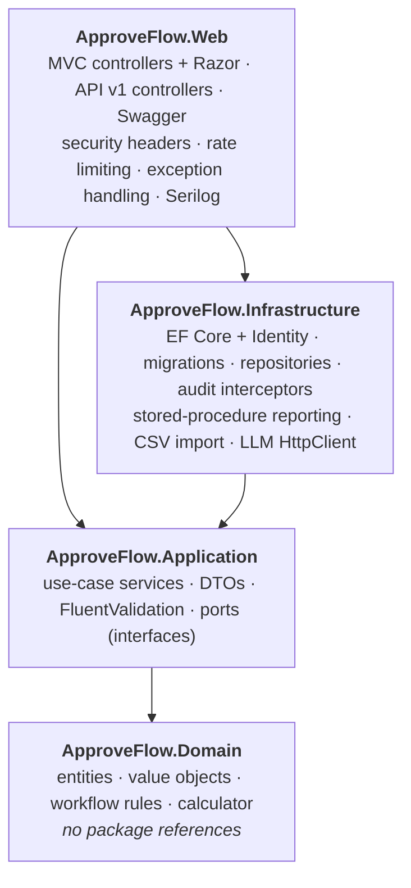
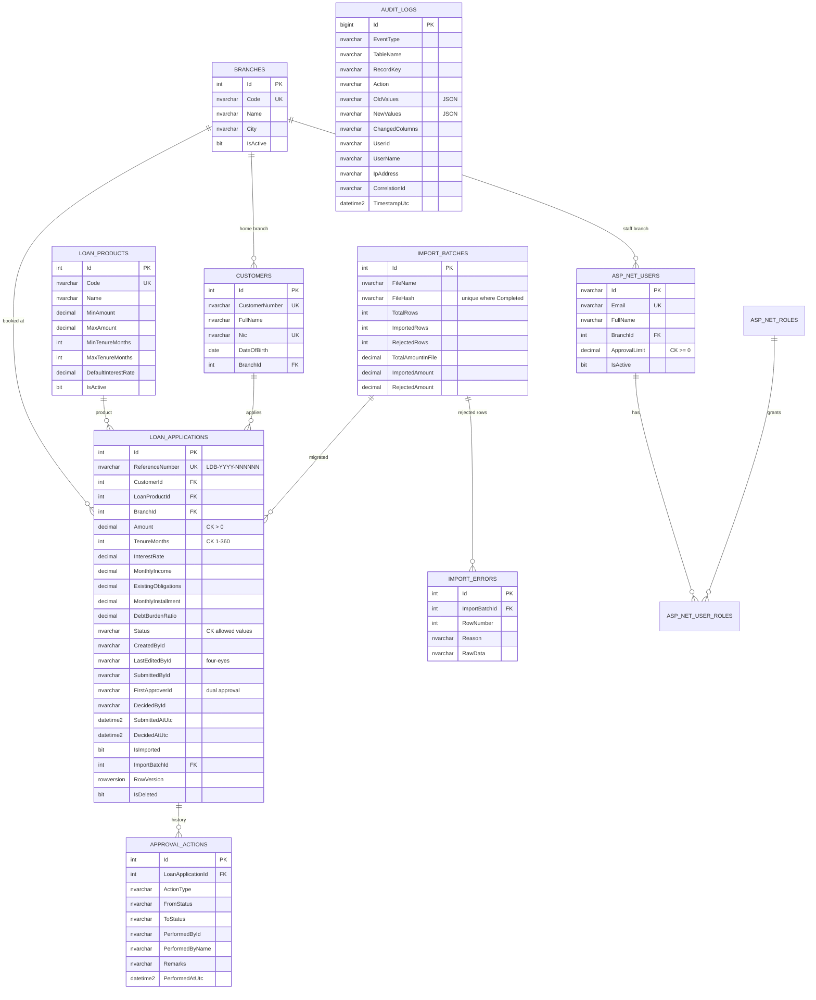
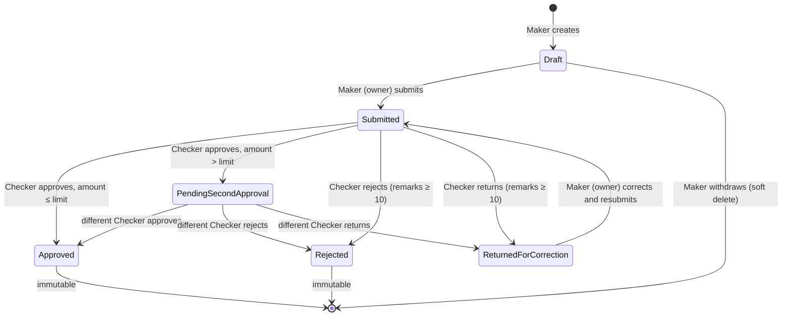
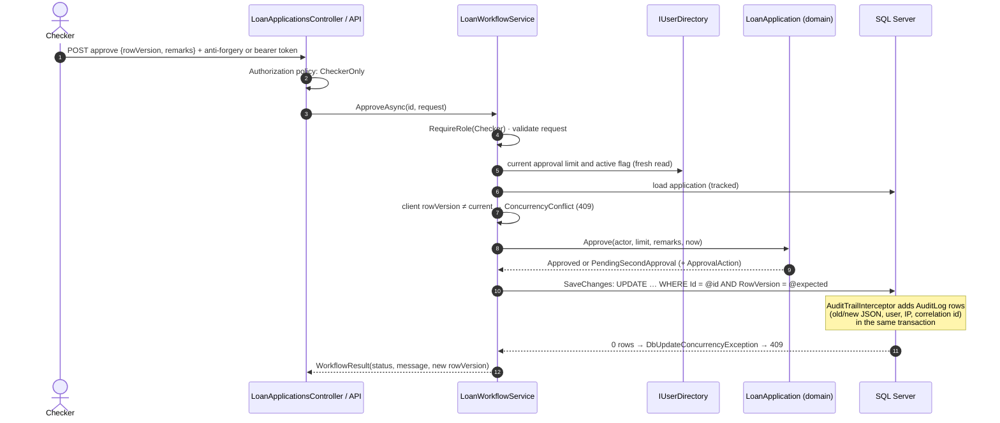

# ApproveFlow – Technical Design

## 1. Architecture

ApproveFlow is a single ASP.NET Core host that serves the MVC user interface and the REST API, organised as Clean
Architecture. Dependencies point inwards only:

| Layer | Responsibility | Must not |
|---|---|---|
| Domain | The `LoanApplication` aggregate and its state machine, four-eyes, limits, dual approval, remarks, immutability, EMI/DBR | Reference EF, ASP.NET or any package |
| Application | Orchestrate use cases: role checks, validation, concurrency, transactions via `IUnitOfWork`, DTO mapping | Reference EF Core or HTTP |
| Infrastructure | Implement the ports: persistence, Identity, auditing, reporting, import, AI client | Contain business rules |
| Web | HTTP concerns: authentication schemes, authorization policies, model binding, views, ProblemDetails | Call the database directly |

Business rules are enforced at three levels (defence in depth): the controller authorization policy, the application
service role check, and the domain invariant. The UI only *reflects* permissions (`LoanApplicationPermissions`) and
never decides them.

## 2. Data model

Every audited table also carries `CreatedAtUtc/ById/ByName` and `UpdatedAtUtc/ById/ByName`. Domain foreign keys are
`NO ACTION` on delete. `AuditLogs` has no foreign keys, so audit history survives any reference-data change. Index,
constraint and trigger details are in [`../database/README.md`](../database/README.md).

## 3. Workflow state machine

Guards evaluated by `LoanApplication` on every decision, in this order:
1. Not deleted, and the status is Submitted or PendingSecondApproval (otherwise **409**).
2. **Four-eyes**: the actor is not the creator, last editor or submitter (otherwise **403**).
3. **Dual control**: in PendingSecondApproval the actor is not the first approver (otherwise **403**).
4. Remarks are present (reject/return) and within length (otherwise **422**).

A return clears any first approval, so a corrected application starts its approval from scratch.

## 4. Key flows

### 4.1 Approve with optimistic concurrency and atomic audit

### 4.2 Audit interceptor and generated keys

Rows with database-generated identity keys do not know their key until after the INSERT. The interceptor:
1. In `SavingChanges`, builds audit entries. Rows with known keys are added to the same batch. Rows with temporary
   keys are deferred and, if the caller has no transaction, a transaction is opened.
2. In `SavedChanges`, writes the deferred audit rows with the real keys and commits.
3. In `SaveChangesFailed`, rolls back.

Either the change *and* its audit record are committed, or neither is. Excluded from audit JSON: `PasswordHash`,
`SecurityStamp`, `ConcurrencyStamp`, `RowVersion` and login-counter noise. Security events use `IAuditTrail`, which
writes through a separate short-lived `DbContext` so recording an event never flushes unrelated pending changes.

### 4.3 Data migration

`LegacyLoanImportService`: hash the file (SHA-256) and refuse it if already imported → parse with CsvHelper
(header validated) → validate each row with the **same domain rules** (`LoanTerms`, `LoanProduct.EnsureWithinLimits`,
`Customer.IsValidNic`) plus reference uniqueness → in one transaction: insert the batch, new customers, applications
(`LoanApplication.CreateFromLegacy`, history entry *Imported*) and `ImportError` rows → `Complete()` with
reconciliation totals. Imported + rejected always equals total for both rows and amounts.

### 4.4 AI risk summary

`RiskSummaryAppService` (Application) builds a `RiskSummaryInput` from the application. This type has **no field**
capable of carrying personal data: product, amounts, tenure, rate, income, obligations, EMI, DBR and loan-to-income
only. `LlmRiskSummaryService` (Infrastructure, typed `HttpClient`) calls the Claude Messages API (model, endpoint,
key and effort from configuration) with schema-constrained JSON output and the server-side fallback option. It
checks `stop_reason` for refusals, validates the JSON, and on any failure returns the deterministic
`RuleBasedRiskAssessor` result. The anonymised payload, the source model and the outcome are written to the audit trail.

## 5. Key design decisions

| # | Decision | Rationale / trade-off |
|---|---|---|
| D1 | **Rich domain model**: the state machine and rules live in `LoanApplication` with private setters | Rules cannot be bypassed by any caller (UI, API, import, seed). Tests can exercise the rules without a database. |
| D2 | **Repositories + unit of work**; Application has no EF reference | Keeps use cases persistence-agnostic and lets the test host reuse the production DI graph. Costs some mapping code. |
| D3 | **`PendingSecondApproval` status** for dual approval instead of a hidden flag | Makes dual control visible in queues, reports and the state diagram, and keeps the rule auditable. The second approver must be a different checker; product maximums cap total exposure. |
| D4 | Separate `LastEditedById`/`SubmittedById` from generic `UpdatedBy` | A checker's first approval updates the row, but must not make *them* "the last modifier" for four-eyes purposes. |
| D5 | **SQL Server `rowversion`** sent to clients as Base64 and checked twice (fast check and UPDATE predicate) | Clear UX on stale screens, and correct under true races. |
| D6 | **Audit via `SaveChanges` interceptor**, transactional, plus DB trigger and `DENY` script | Centralised, cannot be forgotten in a new feature, tamper-resistant at three levels. |
| D7 | **T-SQL objects in `/database`, embedded into a migration** and wrapped in `EXEC(N'…')` | One source of truth. Works with `database update` and in idempotent scripts, where `CREATE PROCEDURE` cannot sit inside `IF … BEGIN`. |
| D8 | **Reports via stored procedures + parameterised ADO.NET** (multiple result sets) | Shows RDBMS depth, avoids N+1 aggregation in the app, and keeps time-zone and turnaround logic close to the data. A LINQ equivalent runs on SQLite. |
| D9 | **SEQUENCE for references**, year from Asia/Colombo | Atomic and contention-free under concurrency, without locking the table. Gaps are acceptable. |
| D10 | **Provider-aware model**: SQL Server in production, SQLite for tests and the demo | CI needs no SQL Server. Provider differences (rowversion, decimals, sequence) are isolated in `ApplicationDbContext`. The model cache key includes the provider. |
| D11 | **UTC everywhere + Asia/Colombo for display and business-day filters** | Unambiguous storage (verified on a server set to Nepal time, UTC+05:45). Report procedures convert parameters once to stay sargable. |
| D12 | **Enums stored as strings**, check constraint on `Status` | Readable stored procedures and DBA queries; the database rejects invalid statuses. |
| D13 | **Cookie auth for UI, JWT for API**; API controllers accept bearer only | The API is not exposed to CSRF; UI posts are protected by anti-forgery tokens. |
| D14 | **JWT revocation check** (`IsActive`, lockout, hashed security stamp) on every API request | Deactivation and role changes apply immediately, at the cost of one indexed user lookup per request. |
| D15 | **Strict CSP**: no inline script or style anywhere; libraries served locally | Strong XSS mitigation. Charts read data from `application/json` blocks; AI output is rendered with `textContent`. |
| D16 | **ProblemDetails with stable `code`s**; business failures via an MVC filter, unexpected ones via `IExceptionHandler` | Predictable client contract; expected 4xx are not logged as errors; no stack traces in any environment for the API. |
| D17 | **Lazy configuration binding** (options pattern) | Test hosts and deployment environments override any setting without code changes. |
| D18 | **Target framework in `Directory.Build.props`, versions in `Directory.Packages.props`** with conditional Microsoft.* versions | Switching to .NET 8 for a constrained host is one property; source kept at C# 12. |

## 6. Cross-cutting concerns

- **Logging**: Serilog to console and daily rolling files (30-day retention, 50 MB roll). Request logging; the
  correlation id (`TraceIdentifier`) is stored in each audit row, linking audit and application logs.
- **Validation**: FluentValidation in services is authoritative and returns 422 with field errors. Domain rule
  violations are mapped to fields where applicable (for example, amount outside the product range → `Amount`).
  DataAnnotations on view models give immediate client-side feedback.
- **Time**: `TimeProvider` is injected everywhere, so time is deterministic in tests.
- **Configuration**: `appsettings.json` (no secrets), `appsettings.Development.json`, user-secrets in development,
  environment variables in hosting. `appsettings.Example.json` documents every key.
- **Health**: `/health` checks the database.

## 7. Testing strategy

| Level | Scope | Tooling |
|---|---|---|
| Domain unit | State machine, four-eyes, dual approval, remarks, immutability, calculator, role combinations | xUnit, no I/O |
| Service integration | Workflow, concurrency (stale and true race), audit interceptor, import, reports, AI fallback, bootstrap admin | Real DI graph + SQLite in-memory (`SqliteTestHost`) |
| HTTP integration | API status codes, JWT, revocation, OpenAPI, security headers, anti-forgery, lockout | `WebApplicationFactory<Program>` |
| Static SQL | Every `/database` script and the idempotent schema parse as T-SQL (SQL Server 2022 grammar) | `Microsoft.SqlServer.TransactSql.ScriptDom` |
| UAT | Business scenarios by role | [`UAT-Test-Plan.md`](UAT-Test-Plan.md) |

The stored procedures' *runtime* behaviour is covered by the UAT plan on SQL Server. On SQLite, CI runs equivalent
LINQ queries that produce the same result shapes.
